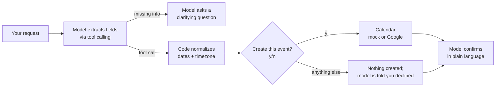

# Kairos

**Build your first AI agent and learn to evaluate it, in plain Python, mainly with
Claude.** *Kairos* is Greek for "the right moment."

Kairos is for developers who want to build an agent and write evals but haven't known
where to start. Everything is small enough to read in one sitting: one agent, one tool,
and one eval script you can run for free.

The example agent schedules meetings. You type a request in plain English, and it
becomes a calendar event, but only after you confirm it. The calendar is just the
teaching example. The same patterns apply to any agent that acts on someone's behalf.

You'll learn how to:

- **Build a tool-calling agent** with Claude: describe a tool, let the model fill in the
  arguments, run it in your code, send the result back
- **Add a human approval gate** so the agent asks before doing anything with real effects
- **Write your first eval**: fixed test requests, expected answers, automatic scoring
- **Check whether you need an LLM at all** by scoring a simple non-AI baseline the same way
- **Run the same agent on another LLM API** (Gemini), to see it's a small change, not a rewrite
- **Expose the tool over MCP**, so Claude Code or Claude Desktop can use it with no agent
  code of your own
- **Read your results on a dashboard**, with token usage and trends, and earn
  [badges](docs/progress.md) as you go

> **Free to try.** The eval baseline and a saved Claude run need no API key, and the
> agent runs on a mock calendar by default, so nothing you try sends a real invite.

## Quick start (about 10 minutes)

You need Python 3.11 or later and git. New to Python projects or API keys? The
[step-by-step quickstart](docs/quickstart.md) explains every command, including Windows.

```bash
git clone https://github.com/archjayas/kairos.git
cd kairos
python3 -m venv .venv && source .venv/bin/activate    # Windows: .venv\Scripts\Activate.ps1
pip install -r requirements.txt
```

**1. Try it free, with no API key:**

```bash
python evals/run_evals.py --models baseline                          # the no-AI baseline
python evals/run_evals.py --replay evals/recordings/sample_run.json  # a saved Claude + Gemini run
python evals/dashboard.py --results evals/recordings/sample_run.json # the same, as charts
```

**2. Schedule a meeting with Claude** (on the mock calendar). This needs an
[Anthropic API key](https://console.anthropic.com) and costs a few cents:

```bash
export ANTHROPIC_API_KEY="..."
export CLAUDE_MODEL="claude-opus-5-5"     # any current Claude model id
python claude_agent.py
```

**3. See your progress.** Kairos notices what you've done and awards
[badges](docs/progress.md) as you go:

```bash
python progress.py
```

## Two paths through the same tool

| Path 1: build the agent yourself | Path 2: use the tool over MCP |
|---|---|
| `python claude_agent.py`: your code runs the agent loop, step by step | `mcp_server.py`: Claude Code or Claude Desktop runs the loop |
| Learn how an agent works under the hood | Learn how to make a tool reusable by any AI app |
| Needs an Anthropic API key | No API key: uses your Claude Code or Claude Desktop sign-in |

**Which path?** Ask: *am I building my own app, or adding a capability to an AI app I
already use?* New to agents, or building your own app? **Path 1.** Extending Claude Code
or Claude Desktop? **Path 2** ([set it up](docs/how-to/use-mcp.md)). Not sure? Do Path 1
first: writing the loop once makes it clear what an MCP client does for you. The
[Overview](docs/overview.md#which-path-should-i-choose) compares them in detail.

## How the example agent works



Both agents share one module, [`calendar_tools.py`](calendar_tools.py): the tool's
fields, the system prompt, date handling, the approval step, and the calendars. The
agent files hold only the part that's specific to each API.

## Learn more

| Start with | Then |
|---|---|
| [Overview](docs/overview.md): what you'll learn, how agents and evals work | [Run the eval](docs/how-to/run-the-eval.md) and the [eval dashboard](docs/eval-dashboard.md) |
| [Quickstart](docs/quickstart.md): clone to first meeting, step by step | [Use Kairos over MCP](docs/how-to/use-mcp.md) (Path 2) |
| [Glossary](docs/glossary.md): every term in plain language | [Claude and Gemini side by side](docs/PORTING.md) |
| [Troubleshooting](docs/troubleshooting.md): errors and fixes | [Bundle Kairos as a Claude Code plugin](docs/how-to/package-as-plugin.md) |

The docs are also a website, with a home page, search, and your badges: run
`pip install -r requirements-docs.txt && mkdocs serve` and open http://127.0.0.1:8000.

## Why I built this

Most of my work building LLM-powered tools has been internal and can't be shared. This
repo is a small, public version of the practices I rely on in that work: keep a human
in the loop before an AI takes an action, let code own what code does reliably, measure
the AI against a simple baseline before trusting it, and write docs that a newcomer can
follow.

I also wanted to lower the barrier for developers who assume agents and evals are only
for AI specialists. Seeing a complete, working agent that's small enough to read in one
sitting helps a lot more than another abstract explanation.

I picked calendar scheduling as the example on purpose. Everyone understands the task,
the output is easy to check, and it has real stakes: an event sends invites to real
people, and dates and timezones are a classic place for models to be confidently
wrong. I first built it on Gemini, then ported it to Claude, which the lessons now use,
to see what it actually takes to move an agent between providers. I wrote that up in
[`docs/PORTING.md`](docs/PORTING.md), along with friction logs for both APIs, because
that's the developer experience I want to help improve.

## Design patterns

The calendar is the example. These patterns are the point, and they carry over to any
agent that acts on a user's behalf.

| Pattern | Why it matters | Where it lives | Status |
|---|---|---|---|
| **Human approval before any write** | An agent that acts on your behalf should never surprise you. The gate is in code, so a prompt can't talk its way past it. | `run_tool_call()` in [`calendar_tools.py`](calendar_tools.py) | Built |
| **Code owns the deterministic work** | Models read language well. Date arithmetic and UTC offsets are better done by code that's always right. | `normalize_datetime()`, `format_local_time()` | Built |
| **Explicit source boundaries** | The model is told to use only what's in the request and never invent an email or link. Then that rule is measured, not assumed. | System prompt + made-up-field rate in the eval | Built |
| **Beat a measured baseline** | An LLM should earn its cost. Comparing it with a no-LLM baseline shows which fields actually need a model. | [`evals/baseline_extractor.py`](evals/baseline_extractor.py) | Built |
| **Golden set with repeatable results** | You can only tell whether a prompt or model change helped if the eval gives the same answer twice. "Today" is pinned. | [`evals/cases.jsonl`](evals/cases.jsonl), [`evals/run_evals.py`](evals/run_evals.py) | Built; regression gate on the roadmap |
| **One source of truth across providers** | The tool schema is defined once and wrapped per API, so the two agents can't drift apart. | `TOOL_PARAMETERS` → `GEMINI_TOOL`, `CLAUDE_TOOL` | Built |
| **A reusable tool over MCP, with the gate in the server** | The same tool works in any MCP client. An MCP server can't prompt in a terminal, so approval is a preview step plus a one-time confirmation id for the newest preview only, enforced by the server. | [`mcp_server.py`](mcp_server.py) | Built |
| **Safe by default** | A stranger can run everything without risk: mock calendar, secrets git-ignored, example.com addresses only. | `CALENDAR_BACKEND=mock` default | Built |
| **Rules flag problems before you're asked** | Details that can't be right are caught by deterministic checks before the confirmation step, not left to the model. | `run_tool_call()` in [`calendar_tools.py`](calendar_tools.py) | Started: missing fields and end-before-start; more checks on the roadmap |
| **Rubric + LLM-as-judge, checked against humans** | Some qualities (a good clarifying question, an honest report of what happened) can't be string-matched. A judge is only useful once you know how often it agrees with people. | `evals/` | Roadmap |

More on the two central decisions:
[why a confirmation step, and why code handles the dates](docs/overview.md#design-decisions).

## Every file in this repo

<details>
<summary>Show all files, with a one-line description of each</summary>

**Code.** Start with `claude_agent.py`; it's the shortest route to seeing an agent work.

| File | What it is |
|---|---|
| [`claude_agent.py`](claude_agent.py) | **Path 1.** The Claude agent: sends your request, reads Claude's tool call, asks you to confirm, sends the result back |
| [`calendar_tools.py`](calendar_tools.py) | Shared by every path: the tool's fields, the system prompt, date and timezone handling, the `y/n` approval step, and the mock and Google calendars |
| [`gemini_agent.py`](gemini_agent.py) | **Path 1, on Gemini.** The same agent on Gemini's API, to compare with the Claude version |
| [`mcp_server.py`](mcp_server.py) | **Path 2.** The same tool as an MCP server, with `current_time`, `preview_event`, and `create_event` |
| [`progress.py`](progress.py) | Shows your progress and badges, in the terminal and as a page in your browser |
| [`kairos_progress.py`](kairos_progress.py) | Records milestones as you use Kairos (locally, in `.kairos/`) and defines the badges |
| [`.mcp.json`](.mcp.json) | Tells Claude Code how to start the MCP server when you open this folder |

**Eval.**

| File | What it is |
|---|---|
| [`evals/run_evals.py`](evals/run_evals.py) | Runs and scores the eval. Never creates an event. Options: `--models`, `--repeat`, `--replay`, `--no-boundary` |
| [`evals/cases.jsonl`](evals/cases.jsonl) | The 20 test requests, one per line, each with its expected answer |
| [`evals/baseline_extractor.py`](evals/baseline_extractor.py) | The non-AI baseline: plain pattern matching, scored the same way as the models |
| [`evals/dashboard.py`](evals/dashboard.py) | Turns eval results into a dashboard page: charts, token usage, every case, and trends |
| [`evals/recordings/sample_run.json`](evals/recordings/sample_run.json) | A saved run of Claude and Gemini, so you can replay the eval without an API key |
| `evals/__init__.py` | Empty. Lets `run_evals.py` import the baseline |

**Docs.** Best read on the website (`mkdocs serve`); on GitHub, some home-page styling
shows as plain text.

| File | What it is |
|---|---|
| [`docs/index.md`](docs/index.md) | The website's home page: a banner, cards grouped for beginners and advanced users, and your badges |
| [`docs/overview.md`](docs/overview.md) | Start here: what you'll learn, how agents and evals work, which path to choose, design decisions, settings |
| [`docs/quickstart.md`](docs/quickstart.md) | Step-by-step setup, from clone to your first meeting |
| [`docs/glossary.md`](docs/glossary.md) | Plain-language definitions of every term used here |
| [`docs/troubleshooting.md`](docs/troubleshooting.md) | Common errors and questions, with fixes |
| [`docs/eval-dashboard.md`](docs/eval-dashboard.md) | The eval dashboard: a live sample, how to make your own, and token costs |
| [`docs/progress.md`](docs/progress.md) | The five badges and how to earn each one |
| [`docs/release-notes.md`](docs/release-notes.md) | What's in each version, and known limits |
| [`docs/how-to/see-your-progress.md`](docs/how-to/see-your-progress.md) | Three ways to see your progress: terminal, progress page, and the local site |
| [`docs/how-to/use-mcp.md`](docs/how-to/use-mcp.md) | Path 2: use the tool from Claude Code or Claude Desktop, and debug it with the MCP Inspector |
| [`docs/how-to/run-the-eval.md`](docs/how-to/run-the-eval.md) | Run the eval, what each check means, the latest results, and how to read them |
| [`docs/how-to/add-eval-cases.md`](docs/how-to/add-eval-cases.md) | Write your own test cases, and keep a held-out set |
| [`docs/how-to/add-a-tool-field.md`](docs/how-to/add-a-tool-field.md) | Add a new field to the tool, in every place it's needed |
| [`docs/how-to/switch-models.md`](docs/how-to/switch-models.md) | Run a different Claude or Gemini model, and compare them |
| [`docs/how-to/change-timezone.md`](docs/how-to/change-timezone.md) | Set your timezone; meetings in other timezones; daylight saving |
| [`docs/how-to/use-google-calendar.md`](docs/how-to/use-google-calendar.md) | Switch from the mock calendar to your real Google Calendar |
| [`docs/how-to/package-as-plugin.md`](docs/how-to/package-as-plugin.md) | Bundle Kairos as a Claude Code plugin, and use it in VS Code |
| [`docs/how-to/publish-the-site.md`](docs/how-to/publish-the-site.md) | Preview the website locally, or publish it to GitHub Pages or any host |
| [`docs/PORTING.md`](docs/PORTING.md) | Claude and Gemini side by side: what changes when you move an agent between APIs |
| [`docs/FRICTION_LOG_CLAUDE.md`](docs/FRICTION_LOG_CLAUDE.md), [`_GEMINI`](docs/FRICTION_LOG_GEMINI.md), [`_MCP`](docs/FRICTION_LOG_MCP.md) | What slowed me down in each API or SDK, with suggested fixes |
| [`docs/stylesheets/extra.css`](docs/stylesheets/extra.css) | Styles for the website: banner, audience labels, cards, badges |
| [`docs/assets/logo.svg`](docs/assets/logo.svg) | The Kairos logo: a clock badge whose hand is a check mark. Used in the banner, header, and browser tab |
| [`docs/assets/badges/`](docs/assets/badges/) | The five badge images, shown on the progress page |
| [`docs/assets/dashboard/sample.html`](docs/assets/dashboard/sample.html) | The sample dashboard shown on the website, built from the saved run |

**Project files.**

| File | What it is |
|---|---|
| [`requirements.txt`](requirements.txt) | The Python packages to install, with exact versions (including `tzdata`, which Windows needs for timezones) |
| [`requirements-docs.txt`](requirements-docs.txt) | Extra package for building the website only (Material for MkDocs) |
| [`mkdocs.yml`](mkdocs.yml) | Website settings: menu, theme, search, and the repo URL used for code links |
| [`mkdocs_hooks.py`](mkdocs_hooks.py) | At build time, turns links to code files into GitHub links, and fills in the badge section (your own badges with `mkdocs serve`) |
| [`overrides/main.html`](overrides/main.html) | The website's quick-access bar: links to the most-used pages, shown on every page |
| [`.gitignore`](.gitignore) | Keeps secrets (`.env`, `credentials.json`, `token.json`, Google's `client_secret*.json`) and local files out of git |
| [`LICENSE`](LICENSE) | MIT License |

</details>

## Roadmap

- **Harder eval:** held-out messy cases, results across repeated runs, the ablation of
  the "don't invent fields" instruction (the tooling exists: `--repeat`,
  `--no-boundary`), and an LLM-as-judge rubric for the replies, checked against human
  labels.
- **More rule checks before confirmation:** invalid emails, times in the past, weekends
  and off-hours, and offset mismatches, flagged by code, not the model. (Missing fields
  and end-before-start are already caught.)
- **Tests and CI:** pytest with no keys or network, run on every push.

## License

MIT. See [LICENSE](LICENSE).
