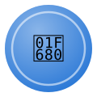
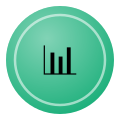
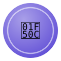

# Progress and badges

Kairos keeps track of what you've done and awards a badge at each stage. You don't
check anything off: the scripts notice when you reach a milestone, and tell you when
you earn a badge.

```bash
python progress.py
```

This prints your progress in the terminal and opens a page with your badges and a
timeline of what you've done. Progress is saved on your computer only, in
`.kairos/progress.json`. Nothing is sent anywhere.

Your badges also appear on the website's home page when you preview it locally with
`mkdocs serve`. Hover a badge to see what it means. On a published site, the home page
shows all five as a preview instead: your personal progress is never published.

## Your badges so far

<!-- KAIROS_BADGES -->

## The badges

<div class="grid cards" markdown>

-   { width="72" } __First Agent__

    ---

    Run the eval for free, then schedule a meeting with the Claude agent.

    [Quickstart steps 2 to 4](quickstart.md)

-   { width="72" } __Evaluator__

    ---

    Run the eval on a live model:
    `python evals/run_evals.py --models baseline,claude`

    [Run the eval](how-to/run-the-eval.md)

-   { width="72" } __Connector__

    ---

    Schedule a meeting through the MCP server, in Claude Code or Claude Desktop.

    [Use Kairos over MCP](how-to/use-mcp.md)

-   { width="72" } __Polyglot__

    ---

    Run the agent or the eval on Gemini, to see the same agent on another LLM.

    [Claude and Gemini side by side](PORTING.md)

-   { width="72" } __Kairos Complete__

    ---

    Earn the other four. You've built an agent, measured it, connected it over MCP,
    and ported it.

</div>

## What counts as each milestone

| Milestone | Recorded when |
|---|---|
| Ran the eval for free | `run_evals.py` runs with `--models baseline` or `--replay` |
| Completed a full tool call with Claude | `claude_agent.py` gets Claude's final reply after a tool call, whether you typed `y` or `n` |
| Ran the eval on a live model | `run_evals.py` calls Claude or Gemini |
| Scheduled a meeting through MCP | The MCP server's `create_event` creates an event |
| Ran Kairos on another LLM | `gemini_agent.py` completes a tool call, or the eval runs Gemini |

Typing `n` at the confirmation still counts: you completed the whole agent loop, and
saying no is part of it.

For every way to check your progress, see [See your progress](how-to/see-your-progress.md).

## Start over

```bash
python progress.py --reset
```

## Related

- [See your progress](how-to/see-your-progress.md)
- [Quickstart](quickstart.md)
- [Eval dashboard](eval-dashboard.md)
- [Overview](overview.md)
